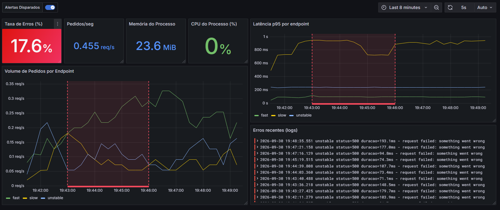

# Golden Signals Observability Stack

A small, fully working observability setup built around the **four golden signals** (latency, traffic, errors, saturation), with metrics, alerting and logs correlated in a single Grafana dashboard.

A test API generates realistic traffic (including deliberate failures), and the stack monitors it end to end.



## Architecture

```
                        metrics
  Flask API  ───────────────────────►  Prometheus ──► Alertmanager ──► Discord
  (:5000)    │                              │
             │                              └─ recording rules + alert rules
             │  JSON logs
             └──────────►  Grafana Alloy ──► Loki
                                               │
                   Grafana  ◄──────────────────┴── Prometheus
                (dashboards, annotations, logs)
```

| Component | Role |
|---|---|
| **Flask API** | Test app with 3 endpoints (`fast`, `slow`, `unstable`). Exposes Prometheus metrics and writes structured JSON logs |
| **Traffic generator** | Sends continuous random traffic, so the dashboards always have data |
| **Prometheus** | Scrapes metrics, evaluates recording rules and alert rules, persistent storage (30 days) |
| **Alertmanager** | Groups and routes alerts |
| **alertmanager-discord** | Small proxy that translates Alertmanager webhooks to Discord messages |
| **Grafana Alloy** | Collects the API log file and ships it to Loki |
| **Loki** | Log storage, queried with LogQL |
| **Grafana** | Dashboard: stat panels, time series, log panel, alert annotations |

## The four golden signals

| Signal | Metric | Panel |
|---|---|---|
| Traffic | `rate(app_requests_total[1m])` | Requests/sec, volume per endpoint |
| Errors | `job:app_error_rate:ratio` (recording rule) | Error rate (%) with color thresholds |
| Latency | `histogram_quantile(0.95, ...)` | p95 latency per endpoint |
| Saturation | `app_process_cpu_percent`, `app_process_memory_bytes` | CPU and memory of the API process |

## Alerts

Defined in `alert_rules.yml`:

- **HighErrorRate**: error ratio on `/api/unstable` above a threshold for a sustained period
- **HighLatency**: p95 latency of `/api/fast` above 0.5s

Firing alerts are also drawn as **annotations** on the Grafana graphs (`ALERTS{alertstate="firing"}`), so a spike can be matched to the moment an alert fired, and to the exact log lines from that interval.

## Running it

**Requirements:** Docker, Python 3.10+, a local Grafana (or add it to the compose file).

1. Create a Discord webhook and put it in a `.env` file (never commit it):
   ```
   DISCORD_WEBHOOK=https://discord.com/api/webhooks/...
   ```
2. Start the stack:
   ```
   docker compose up -d
   ```
3. Start the API and the traffic generator on the host, in two terminals:
   ```
   pip install -r app/requirements.txt
   python app/test_api.py
   python app/traffic_generator.py
   ```
4. In Grafana, add Prometheus (`http://localhost:9090`) and Loki (`http://localhost:3100`) as data sources, then import `grafana/dashboard.json`.

Useful URLs: Prometheus `:9090`, Alertmanager `:9093`, Loki `:3100/ready`, Alloy `:12345`.

## Project structure

```
.
├── docker-compose.yml
├── README.md
├── .env                     (ignored by Git)
├── .env.example
├── .gitignore
├── app/
│   ├── test_api.py
│   ├── traffic_generator.py
│   └── requirements.txt
├── config/
│   ├── prometheus/
│   │   ├── prometheus.yml
│   │   ├── alert_rules.yml
│   │   └── recording_rules.yml
│   ├── alertmanager/
│   │   └── alertmanager.yml
│   └── alloy/
│       └── config.alloy
├── grafana/
│   └── dashboard.json
├── docs/
│   └── dashboard.png
└── logs/                    (ignored by Git)
```

## Things I learned building this

- **Metric dilution.** The first error-rate alert never fired: errors only come from one endpoint, so the global ratio (about 6%) stayed under the threshold. Alerting on the endpoint that can actually fail fixed it.
- **Range windows vs `for`.** With `rate(...[2m])`, an alert needs roughly the window size of history before it can fire, no matter how small `for` is.
- **Recording rules** keep dashboards and alerts consistent: both read the same pre-computed `job:app_error_rate:ratio`.
- **Platform differences.** The default `ProcessCollector` only works on Linux, so saturation metrics use `psutil` to work on Windows too.
- **Container networking.** Inside Compose, services talk by name (`loki`, `alertmanager`); processes running on the host are reached through `host.docker.internal`.
- **Stat panels are for the current value**, time series for evolution. Combining both in one small panel makes each worse.

## Possible next steps

- Saturation time series panels for CPU and memory
- Grafana provisioning (data sources and dashboard as code)
- Run the API inside Compose as well
- Distributed tracing with Tempo
